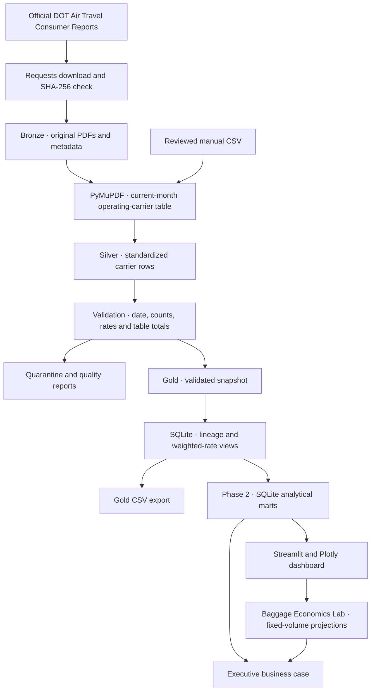

# Lost & Found Economics

## Airline baggage intelligence and financial decision modeling

The business question is where reported baggage mishandling is concentrated and what a measured reduction could mean for operating-cost exposure.

An interactive Streamlit and Plotly dashboard for baggage handling among U.S. reporting operating carriers, backed by a reproducible Python and SQLite pipeline. It extracts the current-month carrier figures from official U.S. Department of Transportation (DOT) Air Travel Consumer Reports, reconciles them to the published monthly totals, and loads SQLite tables and CSV exports for analysis.

The delivered snapshot covers **January–August 2025 and January–August 2026**, with **213 airline-month records**, **14 operating carriers** and **16 official PDFs**. One published rate exceeds the rounding tolerance. The visually verified observation is retained with an explicit flag and both rate values.

## Dashboard

| Section | What you can explore |
| --- | --- |
| Executive Overview | Weighted industry KPIs, monthly trends, matched year-over-year movement, eligible carrier rankings, and volume versus rate |
| Airline Explorer | Two to four carrier series, searchable and sortable rankings, scoped benchmark comparisons, and links to official PDF pages |
| Performance Trends | Selectable volume or rate timelines, paired-year bars, monthly volatility, and a carrier-by-month heatmap |
| Operational Intelligence | Benchmark gaps, traffic and mishandling shares, a consistency matrix, and the data reliability audit |
| Baggage Economics Lab | Editable financial assumptions, fixed-volume scenarios, sensitivity heatmap, benchmark opportunities, and a decision brief |

Reporting year and month bounds apply across the dashboard. The airline filter narrows carrier charts and tables. Industry totals and comparable benchmarks keep their full reporting population, and ranks keep their positions within that population. CSV downloads follow the selected analytical dataset. **Reset** restores the newest reporting year and all airlines.

The interface uses **Premium Aviation Editorial Intelligence**: warm off-white pages, a navy masthead, serif editorial headings, bundled Geist typography, and restrained teal/blue chart palettes. The Economics Lab leads with the modeled outcome, followed by a three-step assumption workspace, scenario comparisons, and a sensitivity heatmap. Detailed design decisions and visual checks are in [the design system](docs/design-system.md) and [redesign verification](docs/redesign-verification.md).

## Data flow



The **Bronze** layer keeps the original PDFs, checksums, and provenance. **Silver** holds parsed and standardized rows. Validation checks the monthly totals and rate tolerances before **Gold** publishes the verified facts to SQLite and CSV.

The stack uses Python, Requests and PyMuPDF for ingestion, Pandas and SQLite for analytics, Streamlit and Plotly for visualization, and Pytest for verification. [U.S. DOT Air Travel Consumer Reports](https://www.transportation.gov/individuals/aviation-consumer-protection/air-travel-consumer-reports)

## Run locally

Use Python 3.11 or newer with SQLite 3.37 or newer (for strict tables). Run these from the project directory. The archive includes the 16 cached PDFs and the generated snapshot.

**Windows PowerShell**

```powershell
py -3 -m venv .venv
.\.venv\Scripts\python.exe -m pip install -r requirements.txt
.\.venv\Scripts\python.exe -m src.pipeline
.\.venv\Scripts\python.exe -m src.analytics.build_marts
.\.venv\Scripts\python.exe -m src.economics.business_case
.\.venv\Scripts\python.exe -m pytest -q
.\.venv\Scripts\python.exe -m streamlit run app/main.py
```

**macOS or Linux**

```bash
python3 -m venv .venv
source .venv/bin/activate
python -m pip install -r requirements.txt
python -m src.pipeline
python -m src.analytics.build_marts
python -m src.economics.business_case
python -m pytest -q
python -m streamlit run app/main.py
```

- `python -m src.pipeline` downloads missing PDFs, verifies existing checksums and rebuilds the snapshot. Every run adds a history entry. Repeating a run with the same sources leaves the observation keys and values unchanged.
- `python -m src.pipeline --offline` requires all selected PDFs to be in the verified local cache.
- `python -m src.pipeline --refresh` checks the pinned PDF URLs with conditional requests when DOT supplies validators. Content-addressed files preserve earlier versions. Review the official archive before updating catalog URLs when DOT replaces a document link.
- `python -m src.pipeline --manual-csv source/manual_verified.csv` enables the reviewed CSV recovery path for PDF parsing failures. The default file is an empty template. Follow the [fallback procedure](docs/sources-and-coverage.md#manual-recovery).
- `python -m src.pipeline --output-root PATH` places data and reports in a separate directory. Use it to keep experimental runs separate from the delivered snapshot.

**Already installed the requirements?** From the extracted project folder, run `python -m streamlit run app/main.py`. This works in Windows Git Bash even when `streamlit.exe` is not on PATH. Open the local URL printed by Streamlit, usually `http://localhost:8501`. Stop the old server with Ctrl+C before starting the redesigned version. Extract the complete folder, including `.streamlit/config.toml`, so native controls use the light theme.

The dashboard reads the bundled SQLite snapshot directly. Rerun the pipeline and mart build above to prepare a fresh snapshot. Use `LOST_FOUND_DB` to point the app at a different local SQLite file with the same marts. The app’s cache keys track changes to the database and SQLite WAL file.

The pipeline logs JSON lines and writes `reports/data_quality.json`. Exit 0 means complete coverage with zero blocking errors. Exit 1 means missing coverage, a blocking validation error or an execution failure. For an incomplete run that reached publication, Gold contains only fully validated months, and the report lists the gaps.

## Phase 2 analytics

Run `python -m src.analytics.build_marts` to rebuild the five live SQLite analytical views from the current validated snapshot. The command is safe to rerun and prints their row counts. Use `--db PATH` for a separately built Phase 1 database. The views reflect subsequent successful fact refreshes automatically.

| Mart | Grain | Delivered rows |
| --- | --- | ---: |
| `mart_airline_performance` | Carrier over the default two-window selection | 14 |
| `mart_monthly_trends` | Target reporting month | 16 |
| `mart_airline_monthly_performance` | Observed carrier-month | 213 |
| `mart_yearly_comparison` | Stable-scope carrier and calendar month paired across years | 93 |
| `mart_data_coverage` | Carrier × target month | 224 |

The 14 parameterized SQL analyses live under `sql/analytics/`. The Python layer in `src/analytics/` exposes filtered Pandas frames for the executive overview, benchmarking, stability, volume analysis and coverage checks. See the [executive insights brief](reports/airline_performance_insights.md), [KPI dictionary](docs/kpi_dictionary.md) and [dashboard data contract](docs/dashboard_data_contract.md).

## Query the snapshot

The SQLite file is `data/gold/baggage.sqlite`. Query `v_airline_monthly_baggage` for carrier-month counts, rates and citation fields. Query `v_monthly_baggage_totals` for count-weighted monthly rates.

```sql
SELECT reporting_year, reporting_month, carrier_count,
       bags_enplaned, bags_mishandled, ROUND(calculated_rate_per_100, 3) AS rate_per_100
FROM v_monthly_baggage_totals
ORDER BY reporting_year, reporting_month;
```

For a rate across several months or carriers, compute `100.0 * SUM(bags_mishandled) / NULLIF(SUM(bags_enplaned), 0)`. Mishandling includes delayed, damaged, lost and pilfered checked bags. The DOT figures cannot identify how many bags were permanently lost.

## Financial model

The weighted observed rate is `100 × mishandled bags ÷ enplaned bags`. The lab holds observed enplanements constant. A relative reduction of `r%` gives an estimated `mishandled bags × r/100` avoided bags. Gross avoided cost is the expected avoided count multiplied by the assumed incremental USD cost. Net benefit subtracts the entered investment once. A benefit-cost ratio is shown when investment is positive. The estimates cover the actual observed months included in the selected window.

The default target is 15%. The $50, $100 and $200 cost presets are illustrative, and the default investment is zero. The three editable comparison targets start at 5%, 15%, and 30%, with shared cost and investment for a comparable baseline. The sensitivity grid highlights the current assumption pair. Scenario and opportunity CSVs retain dates, coverage, and assumptions. Expected counts may be fractional. The summary KPIs show approximate whole bags and compact USD.

Benchmark-alignment opportunity is `MAX(0, observed mishandled − enplaned × benchmark rate/100) × assumed cost`. Ranking eligibility requires the same observed months and stable carrier scope. This identifies where to gather operational evidence and assess feasibility.

The [executive business case](reports/executive_business_case.md) applies a separate illustrative $10 million investment and $100 unit cost to January–August 2026. It can be regenerated with `python -m src.economics.business_case`. [India Aviation Context](docs/india-context.md) is an independent DGCA passenger-complaint panel. [Resume and interview handover](docs/interview-handover.md)

## Three findings from the validated data

- The balanced cohort of 11 carriers improved from 0.5382 to 0.5011 mishandled bags per 100 between the matching 2025 and 2026 windows.
- The 2026 all-reporter monthly rate ranged from 0.3594 in April to 0.6499 in January.
- American and United reported 42.22% of the mishandled bags during the eight-month 2026 window.

## How to read the metrics

- A rate is mishandled bags per 100 enplaned, weighted by bag volume. Rate differences use percentage points. Relative changes are percentages of the prior rate.
- Carrier ranks require consistent reporting scope, complete selected-window coverage, at least three reported months, and at least 100,000 enplanements. The benchmark uses all observed reporting carriers in the applicable periods.
- Matched comparisons use adjacent years, matching calendar months, and consistent carrier scope. The earliest year has no prior match in the snapshot. If a window contains both years, the app compares their overlapping calendar months. When only the later year is selected, the app uses the same months in the earlier year.
- Gray heatmap cells and gaps in carrier lines show where validated observations are unavailable. Operating scope changed for Alaska and Hawaiian, and Spirit has fewer 2026 observations. Read [sources and coverage](docs/sources-and-coverage.md) for the underlying notes.
- The aggregate data does not identify permanently lost bags, operational root causes, or per-incident costs. Volume and performance comparisons are descriptive.

## Project files

| Path | Purpose |
| --- | --- |
| `source/dot_reports.json` | Official report catalog with 16 verified period mappings |
| `app/main.py`, `app/views/` | Dashboard entry point and five reporting sections |
| `src/economics/` | Weighted baseline, fixed-volume simulations, sensitivity, benchmark opportunities, and report generation |
| `data/context/india/` | Independent DGCA extract, PDF, and source metadata |
| `app/components/`, `app/data.py` | Plotly figures, filters, formatting, CSV export, and cached read-only data access |
| `app/styles/theme.css`, `.streamlit/config.toml` | Dashboard styling and native widget theme |
| `src/ingestion/`, `src/extraction/` | Download, checksum, PDF parsing and reviewed CSV recovery |
| `src/transformation/`, `src/validation/` | Type conversion, carrier naming, quarantine and data quality reporting |
| `sql/schema.sql`, `sql/transformations.sql` | Constraints, lineage, indexes and query views |
| `data/bronze/`, `data/silver/`, `data/gold/` | Original sources, cleaned data, SQLite and analytics CSV |
| `sql/analytics/`, `sql/marts/`, `src/analytics/` | SQL analyses, data marts, rebuild command and Python API |
| `reports/coverage.csv`, `reports/data_quality.json` | Generated monthly reconciliation and run results |
| [Data dictionary and database schema](docs/data-dictionary.md) | Column definitions, keys and relationships |
| [Sources and coverage](docs/sources-and-coverage.md) | Period selection, coverage, limits and manual recovery |
| [Data quality report](docs/data-quality.md) | Reconciliation results and documented rate exception |
| [Dashboard design direction](docs/design-vision.md) | Aviation intelligence design system |
